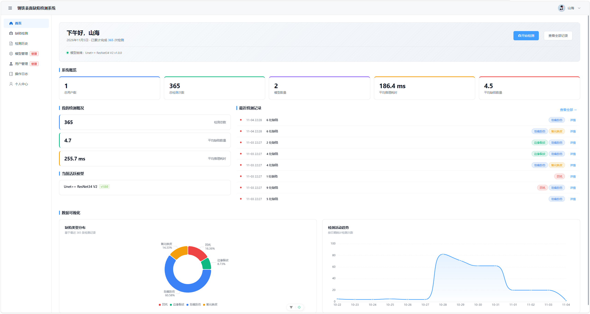
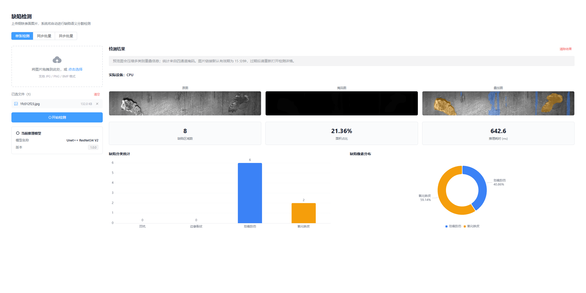
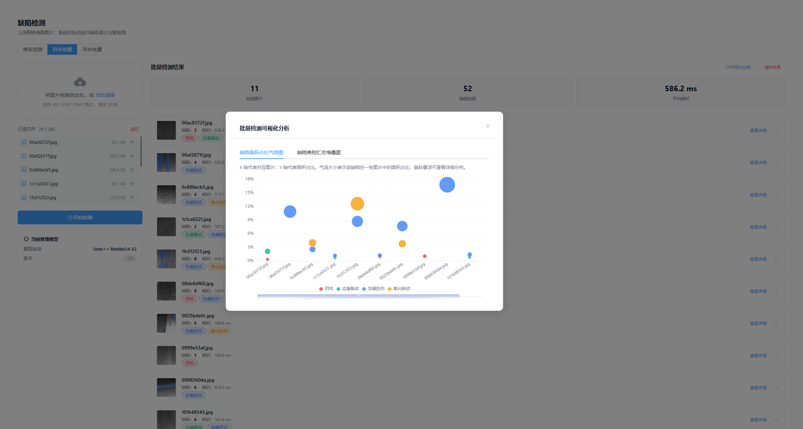

<div align="center">

# SSDD · Steel Surface Defect Detection

**Upload steel surface images, inspect pixel-level defect masks, and trace each result back to the model that produced it.**

[简体中文](./README.md) · **English**

`Vue 3` · `Java 17` · `Spring Boot 3.5` · `ONNX Runtime`

[Screenshots](#screenshots) · [Features](#features) · [Quick Start](#quick-start) · [Architecture](#architecture) · [Build and Verification](#build-and-verification)

</div>

## Screenshots



**Dashboard** · View the active model, recent detections, and the distribution of defect classes.

<details>
<summary><strong>Single-image detection</strong> · Compare the source image, mask, overlay, and defect statistics</summary>



</details>

<details>
<summary><strong>Synchronous batch detection</strong> · Review per-image results and defect area ratios</summary>



</details>

*These screenshots show a local run of the `async-batch` branch with the Chinese UI. The records and timings are from that demo. The async batch option appears on that branch only.*

## Features

| Feature | What you can do |
| --- | --- |
| Four-class defect segmentation | Use a V2 four-channel multi-label model to identify pits, edge cracks, scratches, and iron oxide scale |
| Single-image and synchronous batch detection | Compare source images, masks, and overlays. A synchronous batch accepts up to 20 images and commits its results together |
| Result traceability | Browse detection history, export CSV files, and inspect the model version, inference device, and per-class statistics |
| Model management | Upload, validate, and activate ONNX models as an administrator. CPU inference is the default, with a separate CUDA build available |
| Access and monitoring | Use user and administrator roles, review operation logs, and explore detection summaries and trends |

### Choose a Branch

| Branch | Detection modes | Database migrations |
| --- | --- | --- |
| `main` | Single-image and synchronous batch detection (P0–P5) | V1–V5 |
| `async-batch` | Adds persistent asynchronous batch jobs, progress tracking, bounded retries, and recovery after restart (P5.5) | V1–V6 |

> Use a separate database and data directory for each branch. Keep databases that have applied V6 on `async-batch`.

## Quick Start

### 1. Install Prerequisites

| Component | Local requirements |
| --- | --- |
| Source code and models | Git and Git LFS |
| Backend | JDK 17 and the included Maven Wrapper |
| Frontend | Node.js 24 and pnpm 11.8.0 |
| Data services | MySQL 8.0 or 8.4 and Redis |

The steps below use CPU inference. For CUDA setup and packaging, see the [backend deployment guide in Chinese](./SSDD-backend/README.md).

### 2. Clone the Repository and Download Model Weights

```bash
git lfs install
git clone https://github.com/Solomon-He/SSDD.git
cd SSDD
# For asynchronous batch detection, run git switch async-batch first
git lfs pull
git lfs fsck
```

The weights are in `SSDD-backend/models/`. If a model file still contains a short Git LFS pointer, run `git lfs pull` again to download the ONNX weights.

| Model | Weight file | Approximate size |
| --- | --- | ---: |
| U-Net++ / ResNet34 | `UnetPlusPlus_resnet34_v2_cleaned.onnx` | 104 MB |
| U-Net / DenseNet201 | `Unet_densenet201_v2_cleaned.onnx` | 115 MB |

### 3. Initialize MySQL

Start MySQL and Redis. Run the following SQL with a MySQL account that can create databases and grant privileges. Replace the example password with your own.

```sql
CREATE DATABASE IF NOT EXISTS ssdd
  CHARACTER SET utf8mb4 COLLATE utf8mb4_0900_ai_ci;
CREATE USER IF NOT EXISTS 'ssdd_app'@'localhost' IDENTIFIED BY '<your database password>';
GRANT ALL PRIVILEGES ON ssdd.* TO 'ssdd_app'@'localhost';
```

For containerized or remote MySQL, configure the database account for the actual client host. Flyway creates the tables on first startup.

### 4. Configure and Start the Backend

1. In `SSDD-backend/`, copy `application-local.example.yml` to `application-local.yml`.
2. Set your database credentials, JWT signing key, and Redis connection settings. The example uses Redis port `6380`. Set it to match your Redis instance, whose default port is `6379`. [Configuration and signing key setup](./SSDD-backend/README.md#本地配置)
3. For the first startup, enable `ssdd.bootstrap-admin.enabled` and set the administrator email, display name, and password. Disable this setting after the account is created.
4. Confirm that `java -version` reports Java 17, then run the command for your platform from `SSDD-backend/`.

```powershell
.\mvnw.cmd spring-boot:run
```

```bash
# Linux / macOS
./mvnw spring-boot:run
```

| Local URL | Purpose |
| --- | --- |
| [localhost:3000/health](http://localhost:3000/health) | Backend health check |
| [localhost:3000/actuator/health/readiness](http://localhost:3000/actuator/health/readiness) | MySQL and Redis readiness |
| [localhost:3000/swagger-ui.html](http://localhost:3000/swagger-ui.html) | API documentation in the development profile |

### 5. Start the Frontend and Run Your First Detection

Open another terminal and run the following commands from `SSDD-frontend/`.

```bash
# To install pnpm, run npm install -g pnpm@11.8.0
pnpm install --frozen-lockfile
pnpm dev
```

1. Open the URL shown in the terminal, typically [localhost:5173](http://localhost:5173), and sign in with the administrator account you created.
2. Open Model Management (`模型管理`) and upload an ONNX file from `SSDD-backend/models/`. Select V2 and four channels, enter a name and version, and activate the model.
3. Open Defect Detection (`缺陷检测`), then upload a [sample image](./SSDD-backend/test-images/) to view its mask and overlay.

If you change the frontend or backend address, check the API base URL, image proxy, and CORS settings together. [Frontend integration guide in Chinese](./SSDD-frontend/README.md)

## Architecture

| Layer | Technology and responsibility |
| --- | --- |
| Web interface | Vue 3, TypeScript, Vite, Element Plus, Pinia, and ECharts for image uploads, result comparison, and charts |
| API and access control | Java 17, Spring Boot 3.5.16, and MyBatis-Plus for authentication, model lifecycle, detection, and CSV exports |
| Inference | ONNX Runtime Java for running V2 models and producing class masks, overlays, and region statistics |
| Data | MySQL stores application records and Flyway manages schema migrations. Redis supports rate limiting and caches statistics. The local data directory holds uploaded model copies and images. Async job progress caching is available on `async-batch` |

Back up MySQL and the data directory together in production. Manage machine-specific configuration, credentials, and runtime files in each deployment environment. [Production backend configuration](./SSDD-backend/README.md#迁移数据与部署)

## Build and Verification

From `SSDD-frontend/`, run `pnpm test:p5` and `pnpm build`. On `async-batch`, also run `pnpm test:p55`. The build writes to `dist/`. To preview it locally, run `pnpm preview --host 127.0.0.1 --port 5173`.

From `SSDD-backend/`, run `mvnw.cmd verify` with JDK 17, or `./mvnw verify` on Linux and macOS. Database integration tests require Docker or an explicitly configured local MySQL instance. The full suite also requires Redis and the Git LFS model weights. [Backend verification and packaging](./SSDD-backend/README.md#构建与测试)

The following checks ran from clean checkouts on November 4, 2026, using Windows, MySQL 8.0.34 / 8.4.8, and Redis 8.10.2.

| Branch | Backend tests | Frontend checks | Run with a fresh database |
| --- | --- | --- | --- |
| `main` | 101 passed, 0 skipped | 5 state tests passed, build passed | V5 migration, administrator setup, model activation, and single-image and synchronous batch detection |
| `async-batch` | 123 passed, 0 skipped | 13 state tests passed, build passed | V6 migration and successful publication of async batch results |

Native GPU output comparisons also covered 11 images per model. These checks cover builds, HTTP integration, and model output. Browser end-to-end testing and Linux deployment require separate verification.

## Documentation

| Guide | Contents |
| --- | --- |
| [Frontend README (Chinese)](./SSDD-frontend/README.md) | Stack, local development, builds, and preview |
| [Backend README (Chinese)](./SSDD-backend/README.md) | Environment variables, database migrations, CPU and CUDA packaging, and tests |
| [API reference (Chinese)](./SSDD-frontend/API.md) | Requests and responses for detection, models, authentication, and logs |
