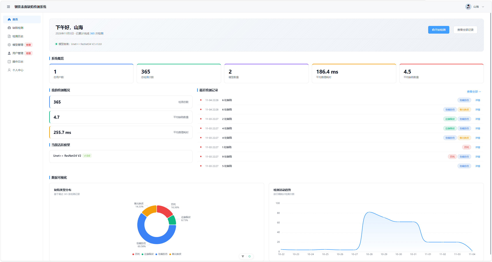
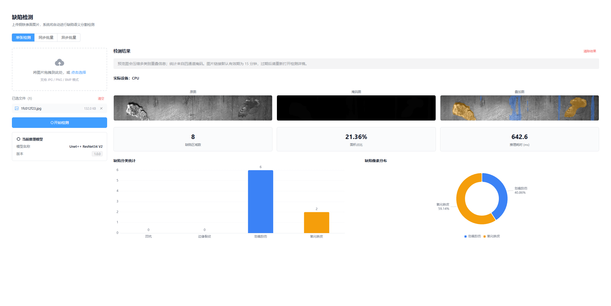
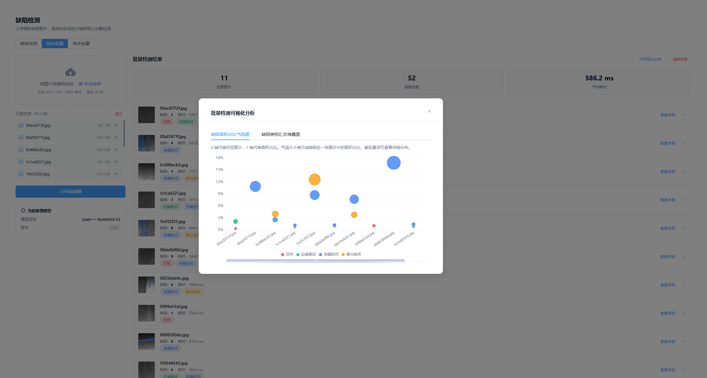

<div align="center">

# SSDD · 钢铁表面缺陷检测系统

**上传钢板图像，查看像素级缺陷掩码，并追溯每次检测的模型与结果。**

**简体中文** · [English](./README.en.md)

`Vue 3` · `Java 17` · `Spring Boot 3.5` · `ONNX Runtime`

[运行示例](#运行示例) · [核心能力](#核心能力) · [快速开始](#快速开始) · [技术架构](#技术架构) · [构建与验证](#构建与验证)

</div>

## 运行示例



**首页仪表盘** · 查看当前模型、近期检测记录和缺陷分布。

<details>
<summary><strong>单张检测</strong> · 查看原图、掩码、叠加图和缺陷统计</summary>



</details>

<details>
<summary><strong>同步批量</strong> · 查看逐图结果和缺陷面积占比</summary>



</details>

*截图取自本地 `async-batch` 分支。图中的记录与耗时是该次运行的样例。异步批量入口仅在该分支显示。*

## 核心能力

| 能力 | 可以做什么 |
| --- | --- |
| 四类缺陷分割 | 使用 V2 四通道多标签模型，识别凹坑、边缘裂纹、划痕刮伤和氧化铁皮 |
| 单张与同步批量 | 查看原图、掩码和叠加图。同步批量最多 20 张，检测结果整批提交 |
| 结果追溯 | 查询历史记录、导出 CSV，查看模型版本、实际推理设备和分类统计 |
| 模型管理 | 管理员可上传、校验和激活 ONNX 模型。默认使用 CPU，可按需构建 CUDA 版本 |
| 权限与运营 | 支持用户与管理员权限、操作日志、检测概况和趋势图 |

### 分支选择

| 分支 | 检测模式 | 数据库迁移 |
| --- | --- | --- |
| `main` | 单张与同步批量（P0～P5） | V1～V5 |
| `async-batch` | 在 `main` 基础上增加持久异步任务、进度查询、受限重试和重启恢复（P5.5） | V1～V6 |

> 两个分支请使用各自的数据库和数据目录。已执行 V6 的数据库应继续搭配 `async-batch` 使用。

## 快速开始

### 1. 准备环境

| 组件 | 本地运行要求 |
| --- | --- |
| 源码与模型 | Git、Git LFS |
| 后端 | JDK 17，仓库自带 Maven Wrapper |
| 前端 | Node.js 24、pnpm 11.8.0 |
| 数据服务 | MySQL 8.0 或 8.4、Redis |

以下流程使用默认的 CPU 推理。CUDA 环境和打包方式见 [后端部署说明](./SSDD-backend/README.md)。

### 2. 克隆项目并获取权重

```bash
git lfs install
git clone https://github.com/Solomon-He/SSDD.git
cd SSDD
# 如需异步批量，先执行 git switch async-batch
git lfs pull
git lfs fsck
```

模型文件位于 `SSDD-backend/models/`。下载后确认拿到的是实际 ONNX 文件。若打开后只有几行 LFS 指针文本，请重新执行 `git lfs pull`。

| 模型 | 权重文件 | 约占空间 |
| --- | --- | ---: |
| U-Net++ / ResNet34 | `UnetPlusPlus_resnet34_v2_cleaned.onnx` | 104 MB |
| U-Net / DenseNet201 | `Unet_densenet201_v2_cleaned.onnx` | 115 MB |

### 3. 初始化 MySQL

启动 MySQL 和 Redis。使用有建库和授权权限的 MySQL 账号执行以下命令，将示例密码替换为你自己的密码。

```sql
CREATE DATABASE IF NOT EXISTS ssdd
  CHARACTER SET utf8mb4 COLLATE utf8mb4_0900_ai_ci;
CREATE USER IF NOT EXISTS 'ssdd_app'@'localhost' IDENTIFIED BY '<自己的数据库密码>';
GRANT ALL PRIVILEGES ON ssdd.* TO 'ssdd_app'@'localhost';
```

容器或远程数据库应按实际客户端来源设置 MySQL 账号授权。首次启动时，Flyway 会自动建表。

### 4. 配置并启动后端

1. 在 `SSDD-backend/` 中将 `application-local.example.yml` 复制为 `application-local.yml`。
2. 填写数据库凭据、JWT 签名密钥和 Redis 连接配置。Redis 示例端口是 `6380`，请按实际服务端口修改（默认 Redis 端口是 `6379`）。[配置示例与密钥生成方式](./SSDD-backend/README.md#本地配置)
3. 首次启动时启用 `ssdd.bootstrap-admin.enabled`，并填写管理员邮箱、显示名和密码。初始化成功后关闭该开关。
4. 确认 `java -version` 为 17，在 `SSDD-backend/` 中运行对应命令。

```powershell
.\mvnw.cmd spring-boot:run
```

```bash
# Linux / macOS
./mvnw spring-boot:run
```

| 本地入口 | 用途 |
| --- | --- |
| [localhost:3000/health](http://localhost:3000/health) | 服务存活检查 |
| [localhost:3000/actuator/health/readiness](http://localhost:3000/actuator/health/readiness) | MySQL 与 Redis 就绪检查 |
| [localhost:3000/swagger-ui.html](http://localhost:3000/swagger-ui.html) | 开发环境 API 文档 |

### 5. 启动前端并完成第一次检测

打开另一个终端，在 `SSDD-frontend/` 中运行以下命令。

```bash
# 首次安装 pnpm 时运行 npm install -g pnpm@11.8.0
pnpm install --frozen-lockfile
pnpm dev
```

1. 打开终端显示的前端地址，默认是 [localhost:5173](http://localhost:5173)，使用刚初始化的管理员账号登录。
2. 进入「模型管理」，上传 `SSDD-backend/models/` 中的一个 ONNX 权重。选择 V2 / 四通道，填写模型名称和版本，然后激活。
3. 进入「缺陷检测」，从 [示例图片](./SSDD-backend/test-images/) 选择一张上传，即可查看缺陷掩码与叠加结果。

如果更改了前后端地址或端口，请同时核对 API 地址、图片代理和 CORS 配置。[前端联调说明](./SSDD-frontend/README.md)

## 技术架构

| 层级 | 技术与职责 |
| --- | --- |
| Web 界面 | Vue 3、TypeScript、Vite、Element Plus、Pinia 和 ECharts，负责上传、结果对照与统计可视化 |
| API 与权限 | Java 17、Spring Boot 3.5.16 和 MyBatis-Plus，负责登录鉴权、模型生命周期、检测与导出 |
| 推理 | ONNX Runtime Java，加载 V2 模型，输出四类掩码、叠加图及区域统计 |
| 数据 | MySQL / Flyway 保存业务记录，Redis 用于限流与统计缓存，本地数据目录保存权重副本与图片。异步任务进度缓存仅用于 `async-batch` |

生产部署时应配套备份 MySQL 和数据目录。本机配置、凭据和运行文件由各部署环境管理。[后端生产配置](./SSDD-backend/README.md#迁移数据与部署)

## 构建与验证

前端在 `SSDD-frontend/` 中执行 `pnpm test:p5` 和 `pnpm build`。在 `async-batch` 上可额外执行 `pnpm test:p55`。构建产物位于 `dist/`，可用 `pnpm preview --host 127.0.0.1 --port 5173` 本地预览。

后端在 `SSDD-backend/` 中使用 JDK 17 执行 `mvnw.cmd verify`（Linux / macOS 为 `./mvnw verify`）。数据库集成测试需要可用的 Docker 或显式配置的本地 MySQL，完整验证还需要 Redis 和 Git LFS 权重。[后端验证与打包说明](./SSDD-backend/README.md#构建与测试)

2026-11-04 在独立检出中完成的验收记录如下。测试环境为 Windows、MySQL 8.0.34 / 8.4.8、Redis 8.10.2。

| 分支 | 后端测试 | 前端验证 | 独立空库运行 |
| --- | --- | --- | --- |
| `main` | 101 项通过，0 跳过 | 5 项状态测试与构建通过 | V5 迁移、管理员初始化、模型激活、单张与同步批量 |
| `async-batch` | 123 项通过，0 跳过 | 13 项状态测试与构建通过 | V6 迁移，另验证异步批量任务成功发布 |

两个模型还各完成 11 张图的原生 GPU 对照。以上记录覆盖构建、HTTP 联调与模型验证，浏览器整页端到端测试和 Linux 部署需另行验证。

## 文档导航

| 文档 | 内容 |
| --- | --- |
| [前端 README](./SSDD-frontend/README.md) | 技术栈、本地开发、构建与预览 |
| [后端 README](./SSDD-backend/README.md) | 环境变量、数据库迁移、CPU / CUDA 打包、测试 |
| [API 约定](./SSDD-frontend/API.md) | 请求与响应、检测、模型、鉴权、日志接口 |
