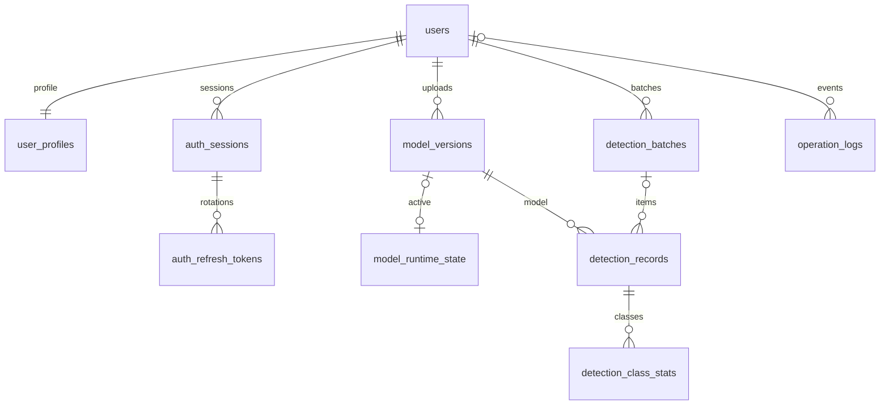

# P1：工程与数据库验收报告

> 日期：2026-11-03  
> 状态：完成。Java 17 构建、真实 MySQL 迁移与打包服务验证通过。  
> 下一阶段：P2 账号与权限。本轮没有实现注册登录、模型管理或检测业务接口。

## 1. 实施内容

| 范围 | 已落实 |
| --- | --- |
| 工程基线 | 保留 IDEA 项目、`org.ssdd` 包、Java 17、Spring Boot 3.5.16、Maven Wrapper 3.9.16 |
| Web 与参数校验 | Spring MVC、Jakarta Validation，默认端口 3000 |
| 数据访问 | MyBatis-Plus 3.5.18、同版 JSqlParser 分页模块、MySQL Connector/J |
| 数据库版本化 | Flyway 11.7.2，由 Boot 管理；三版 SQL 迁移，启动校验、按版本执行 |
| 接口基础 | ApiResponse、PageQuery/PageResult、统一异常及 Servlet 错误兜底 |
| 日志关联 | X-Request-Id 校验/生成、响应头回传、MDC 设置与恢复 |
| 配置 | base/dev/prod 分层，数据库配置启动校验，本地凭据不入资源目录 |
| 跨域 | 开发环境明确来源，Bearer/幂等键/请求 ID 请求头，下载文件名和请求 ID 响应头 |
| OpenAPI | springdoc 2.8.17；开发可用，prod 默认关闭；预留 bearerAuth 方案但尚未接入认证 |
| 健康 | /health、Actuator liveness/readiness；readiness 检查数据库，不输出连接详情 |
| 自动测试 | 6 个 Web 契约、2 个配置、8 个真实 MySQL 集成用例，共 16 个通过 |
| 交付说明 | README、建库 SQL、最终 JAR、打包烟雾验证脚本和验收 JSON |

实际解析依赖见 [dependency-tree.txt](dependency-tree.txt)。本轮没有独立覆盖 Spring Framework、Jackson、Flyway、数据库驱动和测试容器的 Boot 管理版本。

## 2. 本机数据库状态

已使用用户提供的本机 MySQL 连接创建独立 `ssdd` 数据库。实际 MySQL 为 **8.0.34**，本轮保留该服务版本，未升级或调整其他数据库。

- 字符集 utf8mb4，业务表使用 InnoDB。
- Flyway 当前版本 **V3**，3 条成功迁移。
- **10 张业务表 + 1 张 Flyway 历史表**。
- users、detection_records 当前均为 0 行。
- model_runtime_state 仅有 id=1 的初始指针行，active_model_id 为空。
- 集成测试使用独立随机库，结束后检查剩余 P1 测试库数量为 0。

可核实状态见 [database-verification.json](database-verification.json)。没有创建平台默认账号，也未自动导入两个模型；这些分别属于 P2、P3。

总体方案推荐 MySQL 8.4 系列。本轮兼容性结论仅覆盖实际执行的 8.0.34。测试代码提供 Testcontainers MySQL 8.4.8 路径，但本机 Docker engine 未运行，因此没有宣称该容器路径已验收。

## 3. 迁移与表设计

| 迁移 | 表 | 主要约束 |
| --- | --- | --- |
| V1 | users | UUID 字符串、邮箱唯一且大小写不敏感、密码哈希、账号状态 |
| V1 | user_profiles | 独立资料 ID，user_id 唯一外键，admin/inspector 角色约束 |
| V1 | auth_sessions | 稳定登录会话 ID、用户、有效期、撤销状态 |
| V1 | auth_refresh_tokens | 令牌哈希唯一、关联会话、消费/撤销时间、替代令牌链 |
| V2 | model_versions | 仅 V2/4 通道、存储键唯一、SHA-256、真实字节数、推理配置和指标来源 |
| V2 | model_runtime_state | 固定主键 id=1，单个活动模型指针和状态版本 |
| V3 | detection_batches | 用户、模型快照、状态、1～20 张限制、用户级请求幂等键 |
| V3 | detection_records | 原图/结果存储键、尺寸、像素/区域统计、模型配置快照、请求项幂等约束 |
| V3 | detection_class_stats | 记录与类别联合主键，类别仅允许 1～4 |
| V3 | operation_logs | 可空操作者、事件、结果、脱敏 JSON、请求 ID、IP、时间索引 |

会话与刷新历史拆表是对初稿的细化：刷新时保留已消费令牌哈希，后续 P2 可检测旧令牌重放，同时保持 access token 中的会话 ID 稳定。本轮只创建结构，不包含令牌业务逻辑。

数据库不保存公共图片 URL 或绝对磁盘路径，保存逻辑存储键；模型活动状态由唯一指针派生。检测记录保存模型名、版本和推理配置快照，后续模型编辑不会改写历史解释。类别区域/像素跨行总和一致性由 P4 业务事务负责，单行 CHECK 不能替代跨行校验。

所有时间列为 DATETIME(6)，连接配置将数据库会话固定到 UTC。首次迁移和重启均由 Flyway 执行；clean、自动 baseline、Spring SQL 自动初始化已关闭。后续 schema 修改应增加 V4 等新迁移，不能改写已经应用的 V1～V3。

## 4. 接口与错误契约

- 普通业务响应使用 `{success,data?,message?,error?}`，不输出空包装字段；业务对象的可空字段仍可输出 null。
- 分页保持 `{items,total,page,pageSize,totalPages}`。页码从 1 开始，pageSize 默认 10，范围 1～100，空结果 totalPages=0；未启用全局 snake_case。
- /health 独立返回 `{status,timestamp,version}`；CSV、图片等后续响应不做全局 JSON 包装。
- 400/404/405/409/413/415 等框架或业务错误统一映射；意外错误不向调用方返回 SQL、异常细节或堆栈。
- MySQL CHECK 违反使用 HY000/3819，驱动可能抛出 Spring 的 UncategorizedSQLException；已专门映射到安全的 409。数据库连接失败映射 503、查询超时 504，其他内部错误 500。
- 请求 ID 只接受 1～64 位字母、数字、点、下划线和连字符，其余重新生成，处理结束恢复 MDC，避免线程复用串号。

认证与授权仍由 P2 实现；P1 没有提供可操作用户、模型或检测数据的业务端点。测试专用控制器只存在于测试源码，打包验证确认没有发布。

## 5. 配置与打包边界

`application.yml` 提供共有设置，dev 导入工作目录下的可选 `application-local.yml`，prod 要求显式数据库 URL 和数据目录。数据库用户名/密码均需外部提供，配置缺失会启动失败并提示相应变量或本地配置文件。

已将本机凭据写入根目录的 `application-local.yml`；未写入本报告、源码资源、示例配置或 JAR。`.gitignore` 排除本地配置、运行数据、日志和 target。配置对象的 toString 对凭据做隐藏处理。

最终 JAR 已检查：

- 包含三份当前 yml 和三版 Flyway SQL。
- 不包含 application-local.yml、已删除的旧 application.properties。
- 不包含 models/、test-images/ 或 Web 契约测试控制器。

打包服务已实际验证模型原件路由和测试接口均返回统一 404，敏感 Actuator env/configprops 路由未暴露。

## 6. 验收结果

执行环境：Eclipse Adoptium **JDK 17.0.21**，Maven **3.9.16**，Spring Boot **3.5.16**，MySQL **8.0.34**。

| 检查 | 结果 |
| --- | --- |
| JDK 17 编译与 Maven verify | BUILD SUCCESS |
| 自动测试 | 16 通过，0 失败，0 错误，0 跳过 |
| 空临时库迁移 V1～V3 | 通过 |
| V1 数据库升级 V3，已有测试用户保留 | 通过 |
| 重复迁移 | 0 条新迁移，历史仍为 3 条 |
| 邮箱唯一、角色/外键、中文与 emoji | 通过 |
| V2/四通道、单模型指针、令牌哈希唯一、批量与像素约束 | 通过 |
| 真实 MySQL 上 MyBatis-Plus 分页与总数 | 通过 |
| 参数校验、JSON、分页字段、统一错误、请求 ID、CORS | 通过 |
| 缺少凭据、CORS 通配符的负向配置用例 | 按预期拒绝 |
| 打包 dev 启动、dev 重启 | health/readiness/liveness 200，文档入口 200 |
| 打包 prod 启动 | health/readiness/liveness 200，文档入口 404 |
| 临时验证进程与测试库清理 | 已完成 |

自动测试明细见 [test-summary.json](test-summary.json)，最终 JAR 哈希及三次启动结果见 [packaged-smoke.json](packaged-smoke.json)。验证进程已停止，未保留后台服务占用 3000；日常运行按 [README](../../README.md) 启动。

## 7. 进入 P2 的基础与剩余工作

P2 可直接使用 users、user_profiles、auth_sessions、auth_refresh_tokens，实现注册、登录、刷新轮换、撤销、密码/资料、头像、角色管理，并接入 Spring Security。当前没有硬编码平台管理员密码；初始化命令或环境配置将在 P2 实现。

P3/P4 再实现模型导入、存储管理、V2 推理和结果访问。本轮没有加载模型来启动 Web 服务，也没有改动模型和图片内容。MySQL 8.4、生产最小权限账号、Linux/GPU 和部署容量验证仍按后续环境阶段落实。

## 8. 参考

- [Spring Boot 3.5.16 数据库初始化与 Flyway 文档](https://github.com/spring-projects/spring-boot/blob/v3.5.16/spring-boot-project/spring-boot-docs/src/docs/antora/modules/how-to/pages/data-initialization.adoc)
- [Spring Boot 3.5.16 Actuator 文档](https://github.com/spring-projects/spring-boot/blob/v3.5.16/spring-boot-project/spring-boot-docs/src/docs/antora/modules/reference/pages/actuator/endpoints.adoc)
- [MyBatis-Plus 官方安装说明](https://baomidou.com/en/getting-started/install/)
- [springdoc 2.x 官方兼容矩阵](https://springdoc.org/v2/)

兼容性结论以本轮真实构建、SQL 和 HTTP 验证结果为准。
